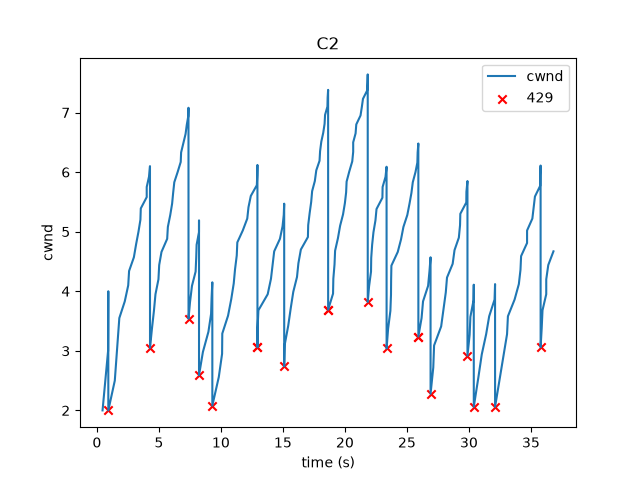

# 컨트롤러 C0·C1·C2 설명

팀원 모두가 발표·질의응답에서 설명할 수 있도록, 각 컨트롤러가 **무엇을 하고, TCP의 무엇에 해당하고, 코드의 어디에 있는지** 정리한다. 코드는 `client/controllers.py`, 생성 함수는 `client/factory.py`, 테스트는 `tests/test_controllers.py`.

## 0. 공통: 실행기와 컨트롤러가 주고받는 것

컨트롤러는 "지금 하나 더 보내도 되나"만 정한다. HTTP 요청은 실행기가 보내고, 응답을 받으면 아래 메서드로 알려 준다.

| 실행기가 하는 일 | 부르는 메서드 | TCP로 치면 |
| --- | --- | --- |
| 보내기 전에 확인 | `can_send()` → `in_flight < cwnd`일 때만 참 | 윈도 안에서만 보냄 |
| 보냄 | `on_send()` → 요청 번호 `req_no` | 시퀀스 번호 |
| 200 받음 | `on_success(req_no, resp)` | ACK |
| 429 받음 | `on_rate_limited(req_no, retry_after)` | 손실 |
| 529 받음 | `on_overloaded(req_no)` | 손실 (서버 전체 혼잡) |
| 422·타임아웃·연결 오류 | `on_error(req_no)` | 혼잡과 무관한 실패 |
| 재시도 전 | `wait_before_retry(attempt)` → 기다릴 초 | 재전송 타이머 |
| 로그 남길 때 | `state()` → `cwnd`, `in_flight`, `ssthresh` | |

공통 부분은 `BaseController`(`controllers.py:48`)에 있다.

- `can_send` (`:57-58`): `in_flight < int(cwnd)`. cwnd가 4.7이면 4개까지 보낸다.
- `on_send` (`:60`): `in_flight`와 요청 번호를 1씩 올린다. 요청 번호는 "같은 바퀴" 판단(C2)에 쓴다.
- `on_error` (`:77`): `in_flight`만 줄이고 윈도는 그대로 둔다. 422(요청이 버킷보다 큼)나 타임아웃은 혼잡 신호가 아니기 때문이다.

**용어: 한 바퀴(round)** — cwnd만큼 보낸 요청의 응답이 모두 돌아오는 시간. TCP의 RTT 하나에 해당한다.

## 1. C0 `FixedWindow`: 고정 동시성 + 즉시 재시도 (나쁜 기준선)

**규칙**: 동시에 `window`개까지 보낸다. 429·529가 와도 윈도를 바꾸지 않고 바로 다시 보낸다.

**코드**: `controllers.py:89-94`. 공통 부분을 그대로 쓰고 cwnd만 고정한다. `wait_before_retry`는 항상 0.

**TCP 대응**: 혼잡 제어가 없는 송신자. 손실이 나도 같은 속도로 계속 보낸다.

**예상 동작**:
- `window`가 작으면(1, 8) 429는 없지만 한도가 남아 느리다.
- `window`가 크면(32, 64) 한도를 넘는 순간부터 429 → 즉시 재시도 → 또 429가 반복된다. 서버 대기열이 넘치면 529도 나온다.
- E1에서 1·8·32·64를 모두 돌리는 이유: "적당한 값을 미리 알면 고정도 괜찮지만, 그 값을 모른다"를 보여 주기 위해서.

## 2. C1 `FixedBackoff`: 고정 동시성 + 지수 백오프·지터 (현업 표준 기준선)

**규칙**: 동시성은 C0처럼 고정. 실패한 요청을 다시 보내기 전에 기다리는 시간을 실패할 때마다 2배로 늘리고, 상한에서 멈춘다. 기다리는 시간은 ±10% 무작위로 흔든다.

```
대기 = min(cap, base × 2^(attempt-1)) × (1 ± jitter)
기본값: base 1초, cap 8초, jitter 0.1 → 1, 2, 4, 8, 8, 8 ... 초 (± 10%)
```

**코드**: `controllers.py:99-114`
- `:112` 이진 지수 백오프: `min(cap, base * 2 ** exp)`
- `:114` 지터: `random.Random(seed)`로 흔들어서 같은 시드면 같은 값이 나온다 (실험 재현용)
- `attempt`는 "이번이 몇 번째 재시도인가"이고 첫 재시도가 1이다. 0이면 기다리지 않는다.

**TCP·수업 대응**: 7주차 이더넷 CSMA/CD의 이진 지수 백오프, TCP 재전송 타이머를 실패마다 2배로 늘리는 것.

**지터가 왜 필요한가**: 여러 에이전트가 같은 순간에 429를 받으면 똑같이 1초, 2초 기다렸다가 다시 한꺼번에 몰린다. 무작위로 흔들면 다시 보내는 시각이 흩어진다.

**C2와의 차이 (발표 예상 질문)**: 백오프는 *기다리는 시간*만 늘리고 *동시 요청 수*는 그대로다. 한도에 맞게 보내는 양을 줄이지 않으니, 기다린 뒤 다시 같은 양을 보내 또 429를 받는다.

## 3. C2 `AIMDWindow`: 슬로 스타트 + AIMD (TCP Reno)

**규칙**:
1. **슬로 스타트**: cwnd < ssthresh이면 성공마다 +1 → 한 바퀴에 2배
2. **혼잡 회피**: cwnd ≥ ssthresh이면 성공마다 +1/cwnd → 한 바퀴에 +1
3. **429·529**: ssthresh = cwnd/2 (최소 1), cwnd = ssthresh → 절반
4. **같은 바퀴의 손실은 한 번만**: 줄이기 전에 보낸 요청의 429는 무시

**코드**: `controllers.py:119-149`

| 줄 | 내용 | TCP 개념 |
| --- | --- | --- |
| `:130-131` | `cwnd < ssthresh`면 `cwnd += 1` | 슬로 스타트 |
| `:132-133` | 아니면 `cwnd += 1 / cwnd` | 혼잡 회피 (덧셈 증가) |
| `:134` | `max_window`로 상한 | 수신 윈도 같은 상한 |
| `:145` | `req_no <= recover_until`이면 무시 | 한 윈도 안의 여러 손실을 한 번으로 (Reno 빠른 회복) |
| `:147-148` | ssthresh = cwnd/2, cwnd = ssthresh | 곱셈 감소 |
| `:149` | `recover_until = sent` | 지금까지 보낸 요청은 같은 바퀴 |
| `:140-142` | 529도 `_decrease` | 529도 손실로 보고 같이 절반 (11주차 결정) |

**기본 매개변수** (`AIMDConfig`, `:40-43`): `init_cwnd=1`, `ssthresh=32`, `max_window=128`. 실험용 최종 값은 E1 설정이 정해진 뒤 확정한다.

### 손으로 따라가 보기 (테스트와 같은 값)

| 상황 | cwnd 변화 |
| --- | --- |
| 슬로 스타트, cwnd=1에서 바퀴마다 전부 성공 | 1 → 2 → 4 → 8 → 16 |
| 혼잡 회피, cwnd=4에서 성공 4번 | 4 → 4.25 → 4.485 → 4.708 → 4.921 (≈ 5) |
| cwnd=8에서 요청 1~8을 보냈는데 8개 모두 429 | 1번 429에서 8 → 4, 2~8번 429는 같은 바퀴라 무시 → 4 |
| 이어서 줄인 뒤 보낸 9번이 429 | 새 바퀴이므로 4 → 2 |
| cwnd=1에서 429 | 0.5가 아니라 1 (최소 1) |

### 왜 성공마다 1/cwnd씩 늘리나 (발표 예상 질문)
한 바퀴에는 cwnd개의 응답이 온다. 각각 1/cwnd씩 더하면 한 바퀴에 정확히 +1이 된다.

### 429가 동시에 10개 오면 10번 줄이나 (발표 예상 질문)
아니다. 10개 모두 줄이기 전에 보낸 요청이라 같은 혼잡에서 나온 것이다. 매번 줄이면 cwnd가 1/1024로 무너진다. TCP Reno가 한 윈도 안의 여러 손실을 한 번의 혼잡으로 보는 것과 같다.

### AIMD가 왜 공정해지나 (Chiu & Jain, E3에서 확인)
덧셈 증가는 모든 에이전트가 같은 양(+1)씩 늘리고, 곱셈 감소는 큰 쪽이 더 많이 줄인다(절반). 이 과정을 반복하면 몫이 같아지는 쪽으로 모인다.

## 4. 실제 서버에서 확인한 C2 동작 (11/12)

P1 서버(API 2.0)에 C2를 붙여 작업 200개를 처리했다 (실행기 연결 전 간이 스크립트).



| 서버 설정 | 429 | 소요 시간 | 결과 |
| --- | --- | --- | --- |
| 예시 설정 (`examples/config.json`) | 308 | 18.1초 | cwnd가 1~2에서만 변동, 톱니 없음 |
| 제안 설정 (`output_token_seconds` 0.02, `slots` 64, `queue_size` 64, `capacity` 3) | 19 | 36.8초 | 위 그래프의 톱니 |

- **예시 설정에서 톱니가 없는 이유**: 요청 1건 지연이 약 0.1초, 한도가 초당 10건이라 적정 동시성이 10 × 0.1 ≈ 1개뿐이다. 처리량 = cwnd ÷ 지연이므로, 톱니를 보려면 (한도 × 지연)이 충분히 커야 한다.
- **한도 활용률 약 54%** (초당 5.4건 / 한도 10건): 톱니 아래쪽 구간에서 한도를 다 쓰지 못한다. AIMD가 "잃는 것".
- **429 횟수는 PC마다 크게 다르다** (같은 설정에서 148회 vs 308회): C2는 429 후 즉시 재시도하므로 PC가 빠를수록 429를 더 많이 받는다. 그래서 5회 반복 평균을 본다.

## 5. 이름으로 만들기 (`client/factory.py`)

```python
from client.factory import make_controller, NAMES
make_controller("C0-32")            # 고정 동시성 32
make_controller("C1", seed=3)       # 지터 시드 3
make_controller("C2", ssthresh=16)  # 매개변수 덮어쓰기
NAMES  # ("C0-1", "C0-8", "C0-32", "C0-64", "C1", "C2") — E1에서 이름만 바꿔 돌림
```

`-숫자`는 C0·C1의 `window`가 된다. `seed`는 무작위를 쓰는 C1에만 넘어간다.

## 6. 정리: 세 컨트롤러 한눈에

| | 동시 요청 수 | 429·529를 받으면 | 재시도 대기 | TCP·수업 |
| --- | --- | --- | --- | --- |
| C0 | 고정 | 아무것도 안 함 | 0 | 혼잡 제어 없음 |
| C1 | 고정 | 아무것도 안 함 | 1, 2, 4, 8초 (지터) | 7주차 이진 지수 백오프 |
| C2 | 성공하면 늘림 | 절반 (같은 바퀴는 한 번) | 0 | 4주차 슬로 스타트·AIMD (Reno) |

C3(토큰 윈도), C4(지연 기반), C5(명시적 신호)는 13주차에 이 문서에 추가한다.
